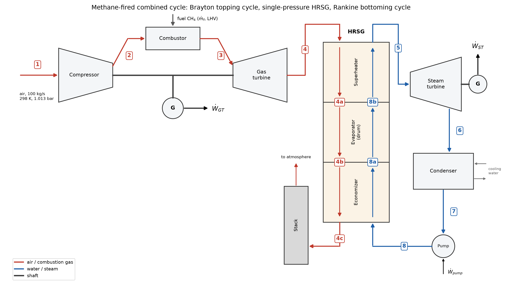

# Surrogate-Assisted Optimization of a Methane-Fired Combined Cycle

ME3160 Power & Refrigeration Cycles, IIT Hyderabad — end-semester term project (Project 1).

A physics-based model of a methane-fired combined-cycle plant (open Brayton topping cycle, single-pressure
heat recovery steam generator, Rankine bottoming cycle) is built with variable-cp ideal-gas mixtures and
CoolProp steam properties, validated against hand-traceable textbook cases, and optimised for overall
efficiency with a Latin-hypercube design of experiments, RSM/ANN surrogates and a genetic algorithm whose
optimum is verified against the direct model. The plant handles 100 kg/s of air.

**Result:** η_cc = **53.94 %**, W_net = **55.7 MW** at r_p = 16.0, TIT = 1500 K, P_s = 60 bar,
T_s = 578 °C, P_cond = 0.05 bar. The surrogate optimum matches a GA run directly on the physics model to
three decimals while using 500 instead of 4800 direct-model evaluations.

## Plant and state numbering



| State | Stream | Location |
|---|---|---|
| 1 | air | compressor inlet (298 K, 1.013 bar) |
| 2 | air | compressor exit |
| 3 | combustion products | turbine inlet (TIT), P₃ = r_p·P₁ |
| 4 | combustion products | gas-turbine exhaust = HRSG gas inlet (1.05 bar) |
| 4a | combustion products | after the superheater |
| 4b | combustion products | after the evaporator (pinch point) |
| 4c | combustion products | stack (1.02 bar) |
| 7 | water | condenser exit, saturated liquid at P_cond |
| 8 | water | feed-pump exit at P_s |
| 8a | water | economizer exit, saturated liquid at P_s |
| 8b | steam | drum exit, saturated vapour at P_s |
| 5 | steam | superheater exit = steam-turbine inlet (P_s, T_s) |
| 6 | steam | steam-turbine exit at P_cond |

Counterflow pairings in the HRSG: 4↔5 (approach), 4a↔8b, 4b↔8a (pinch), 4c↔8.

## Modelling approach

- **Gas properties** (`src/props/gas.py`): every species (N₂, O₂, CO₂, H₂O) uses the Borgnakke & Sonntag
  Table A.6 cp polynomial, integrated analytically for h(T) and s°(T) with h = s° = 0 at 298.15 K. Mixture
  properties are mass-fraction weighted. Air is 21 % O₂ / 79 % N₂ by mole.
- **Isentropic processes** use the entropy function at frozen composition,
  s°(T₂s) = s°(T₁) + R_mix·ln(P₂/P₁); the mixing term cancels. Temperatures are recovered from h or s° by
  Brent's method. No constant cp or constant k is used anywhere.
- **Combustor** (`src/combustor.py`): CH₄ + a(O₂ + 3.76 N₂) → CO₂ + 2H₂O + (a−2)O₂ + 3.76a N₂ with complete
  combustion. The fuel-air ratio is solved from f·LHV·η_f = (1+f)·h_prod(TIT) − h_air(T₂) with LHV = 50 MJ/kg
  and η_f = 0.98; φ = f/f_stoich with f_stoich = 0.05839.
- **Gas turbine** (`src/gas_turbine.py`): compressor on air (η_c = 0.86), turbine on the product mixture
  (η_t = 0.89) expanding from r_p·1.013 bar to 1.05 bar.
- **Steam side** (`src/props/steam.py`, `src/rankine.py`): CoolProp `PropsSI` with `'Water'`; η_st = 0.85,
  η_pump = 0.80, saturated liquid at the condenser exit.
- **HRSG pinch closure** (`src/hrsg.py`): the steam flow is set by an evaporator pinch of exactly 10 K,
  T₄b = T_sat(P_s) + 10 K, ṁ_s = ṁ_gas(h₄ − h₄b)/(h₅ − h₈a). The superheater and economizer balances then give
  T₄a and T₄c. The full T–Q profile is discretised (50 points per section) and the pinch is verified over the
  economizer and evaporator, which catches cold-end temperature crosses at low superheat and high exhaust
  temperature. The superheater hot end is governed by the separate 5 K approach constraint.
- **Direct model** (`src/combined_cycle.py`): `direct_model(rp, TIT, Ps, Ts, Pcond)` returns η_cc =
  (Ẇ_GT,net + Ẇ_ST,net)/(ṁ_f·LHV), Ẇ_net, all states, the T–Q profile, an energy balance and the constraint
  margins (positive = satisfied). It never raises. `direct_model_tau` replaces T_s by τ ∈ [0, 1] inside the
  window [T_sat + 20 K, T₄ − 5 K], which keeps the design space a box.

Constraints (spec §1.4): TIT < 1550 K, HRSG gas inlet < 650 °C, stack > 100 °C, pinch ≥ 10 K,
approach ≥ 5 K, steam-turbine exit quality > 0.88, equivalence ratio < 0.5.

## Validation

All rows are in `results/validation_table.csv` and are asserted in `tests/test_validation.py`.

| Check | What is compared | Tolerance | Largest deviation | Result |
|---|---|---|---|---|
| Check-1 | Air-standard Brayton (r_p 15, 300 K / 1400 K) vs B&S Table A.7.1 hand values | 0.5 % | η_th −0.42 % | all pass |
| Check-2 | Rankine (30 bar, 450 °C, 7.5 kPa) vs B&S steam tables | 0.1 % | w_pump −0.050 % | all pass |
| Check-3 | First-law closure ṁ_f·LHV·η_f = Ẇ_GT + Ẇ_ST + Q̇_stack + Q̇_cond at the baseline | 1e-6 relative | residual 3.7e-14 | pass |
| Textbook | Çengel & Boles Example 10-8 (combined gas–steam cycle) | 1 % | y (steam/gas mass ratio) +0.87 % | all pass |

Check-3 also closes to < 1e-6 at 30 random design points. Check-1 run with the A.6 "Air" row instead of
the 21/79 mixture fails q_h (−0.58 %) and w_net (−0.88 %), which supports the mixture choice.

Baseline (r_p 15, TIT 1400 K, 30 bar, 450 °C, 0.075 bar): η_cc 50.66 %, Ẇ_net 46.1 MW, Ẇ_ST/Ẇ_GT 0.418,
ε_HRSG 0.815, stack 135.5 °C, feasible.

## DOE → surrogates → GA

1. **DOE** (`src/doe.py`): 500-point Latin hypercube (seed 42) over r_p 8–30, TIT 1200–1500 K, P_s 10–60 bar,
   τ 0–1, P_cond 0.05–0.15 bar. 201 points (40.2 %) are feasible and none fail numerically. The most common
   violation is exit quality (287 points), then stack (26), HRSG inlet (9) and pinch (5). Infeasible points
   are kept and labelled.
2. **Surrogates** (`src/surrogates.py`): a full quadratic RSM (statsmodels OLS, ANOVA) and an ANN
   (MLPRegressor, 2 hidden layers, 5-fold grid search) per target on one 80/20 split. T₄ is modelled instead
   of the HRSG-inlet margin so the limit can change without refitting; the TIT and φ margins need no surrogate.

   | Target | RSM test R² | RSM test RMSE | ANN test R² | ANN test RMSE | Selected |
   |---|---|---|---|---|---|
   | η_cc [%] | 0.9963 | 0.181 | 0.9999 | 0.033 | ANN |
   | Ẇ_net [MW] | 0.9999 | 0.098 | 0.9999 | 0.094 | ANN |
   | T₄ [K] | 0.9989 | 2.64 | 1.0000 | 0.56 | ANN |
   | m_quality [-] | 0.9977 | 0.0023 | 0.9999 | 0.0005 | ANN |
   | m_stack [K] | 0.9944 | 2.34 | 0.9999 | 0.37 | ANN |
   | m_pinch [K] | 0.2246 | 0.047 | 0.9979 | 0.0024 | ANN |
   | m_approach [K] | 0.9970 | 4.01 | 0.9999 | 0.62 | ANN |

   The dominant ANOVA terms for η_cc are TIT, r_p×TIT, r_p, P_cond and r_p². The RSM fails on m_pinch because
   that margin is exactly zero except where the economizer cold end crosses, a step the quadratic cannot
   represent; the largest ANN errors also sit at the physics kinks (cold-end crosses, superheated turbine
   exhaust), not at the constraint boundary.
3. **GA** (`src/optimize.py`): pymoo GA (population 100, 200 generations, seeds 1–5) on the selected
   surrogates with normalised margin constraints. A predicted m_pinch ≥ −0.05 K counts as satisfied, because
   the true margin is identically zero and the surrogate reproduces that zero only to ~1e-4 K. The optimum is
   re-evaluated with the direct model; a local LHS refinement loop (50 points, ±10 % box, up to 3 loops)
   runs if the gap exceeds 0.2 percentage points or the point is infeasible. A GA run directly on the physics
   model (population 60, 80 generations) is the reference.

## Optimum

| Quantity | Value |
|---|---|
| r_p | 16.05 |
| TIT | 1500 K (upper bound) |
| P_s | 60 bar (upper bound) |
| T_s | 577.9 °C (τ = 1: approach limit) |
| P_cond | 0.05 bar (lower bound) |
| η_cc | 53.935 % (surrogate 53.947 %, gap 0.012 pp) |
| Ẇ_net / w_net | 55.67 MW / 556.7 kJ/kg air |
| Ẇ_ST/Ẇ_GT | 0.461 |
| ε_HRSG | 0.805 |
| η_GT | 36.93 % |
| ṁ_s | 14.44 kg/s |
| T₄ / T₄c | 582.9 °C / 145.9 °C |
| x₆ | 0.927 |
| φ | 0.354 |
| Margins | TIT 50 K, HRSG inlet 67.1 K, stack 45.9 K, pinch 0, approach 0, quality 0.047, φ 0.146 |
| Active constraints | pinch (by construction) and superheater approach |

The direct-model GA reference finds the same point (η_cc 53.935 %, r_p 16.05, P_s 60 bar).

## Sensitivity and Pareto findings

- **HRSG-inlet limit** (re-optimised at 600, 650 and 700 °C): the efficiency optimum does not move. T₄ =
  583 °C sits below even the 600 °C limit, so the tube-material limit is not what caps efficiency.
- **One-at-a-time levers at the optimum** (direct model, τ = 1 held, nothing re-optimised):

  | Lever | Δη_cc [pp] | ΔẆ_net [MW] |
  |---|---|---|
  | TIT +50 K (to 1550 K, A.6 extrapolated) | +1.014 | +4.83 |
  | P_cond −0.01 bar | +0.310 | +0.32 |
  | P_s +10 bar | +0.040 | +0.04 |
  | HRSG-inlet limit ±50 K | 0.000 | 0.00 |
  | Superheater approach 5 → 10 K | −0.006 | −0.01 |
  | Evaporator pinch 10 → 15 K | −0.276 | −0.29 |

  Turbine inlet temperature is by far the biggest lever, so materials spending is best directed at the gas
  turbine hot section rather than the HRSG tubes.
- **Pareto fronts** (NSGA-II on the surrogates, η_cc vs Ẇ_net): the high-efficiency end is the
  single-objective optimum for every limit. Lowering r_p raises Ẇ_net at the cost of efficiency until T₄
  reaches the HRSG-inlet limit, so the limit shapes only the high-power end: maximum Ẇ_net is 56.6, 59.6 and
  62.0 MW at 600, 650 and 700 °C. The knee of the 650 °C front is at r_p 13.5 (57.6 MW, 53.87 %), giving up
  0.08 pp of efficiency for +2.1 MW; this is the recommended operating point. Verified front points agree
  with the direct model to ≤ 0.03 pp in η_cc; Ẇ_net is under-predicted by up to 0.57 MW at the r_p = 8 corner,
  where the 700 °C end point is also 4.2 K over its limit on the direct model.

## How to run

```powershell
python -m venv .venv
.venv\Scripts\Activate.ps1
pip install -r requirements.txt
python run_all.py            # everything, including the ~3 min direct-model reference GA
python run_all.py --quick    # skip the direct-model reference GA
pytest
```

Individual stages can be run as modules, e.g. `python -m src.validation` or `python -m src.optimize`.

## Repository structure

```
run_all.py                single driver: regenerates every table and figure
src/props/gas.py          A.6 variable-cp species and mixtures, isentropic solve
src/props/steam.py        CoolProp water/steam wrappers
src/combustor.py          stoichiometry and fuel-air solve
src/gas_turbine.py        Brayton topping cycle, eta vs rp study
src/rankine.py            Rankine bottoming cycle, T-s plot
src/hrsg.py               pinch-closed HRSG and T-Q profile
src/combined_cycle.py     direct_model, direct_model_tau, baseline plots
src/validation.py         Check-1/2/3, Cengel Ex. 10-8, combined validation table
src/doe.py                Latin hypercube DOE
src/surrogates.py         RSM + ANN surrogates, ANOVA, parity and failure analysis
src/optimize.py           surrogate GA, direct verification, refinement, direct-model GA reference
src/sensitivity.py        HRSG-limit and one-at-a-time lever studies
src/pareto.py             NSGA-II Pareto fronts and knee point
src/schematic.py          plant block diagram
tests/test_validation.py  all validation and regression tests
textbook_tables/          B&S Table A.6 / A.7.1 and Cengel Ex. 10-8 transcriptions
results/                  generated tables (CSV)
figures/                  generated figures (PNG)
```

## Limitations

- Table A.6 polynomials are valid for 250–1200 K but are used up to 1500 K (1550 K in the TIT lever study).
  Against Table A.7.1 the air-mixture enthalpy error is ≤ 0.67 % up to 1200 K and −0.45 % at 1500 K, and the
  N₂/O₂ cubics give cp ≤ 0 above ~2200 K, so temperature inversions are bracketed below that point.
- The Çengel comparison uses Çengel's air table and steam tables against the A.6 mixture and CoolProp, so
  differences of up to ~1 % are expected from the property sources alone.
- No combustor pressure drop is modelled (none is given in the specification), and blade cooling is omitted.
- The evaporator pinch is fixed at exactly 10 K to close the steam flow, so it is always active by
  construction; a single-pressure HRSG without reheat is assumed.
- T–s diagrams of the gas side exclude the entropy of mixing.
